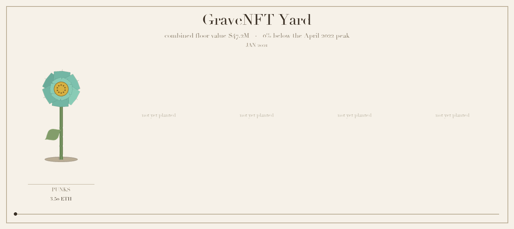
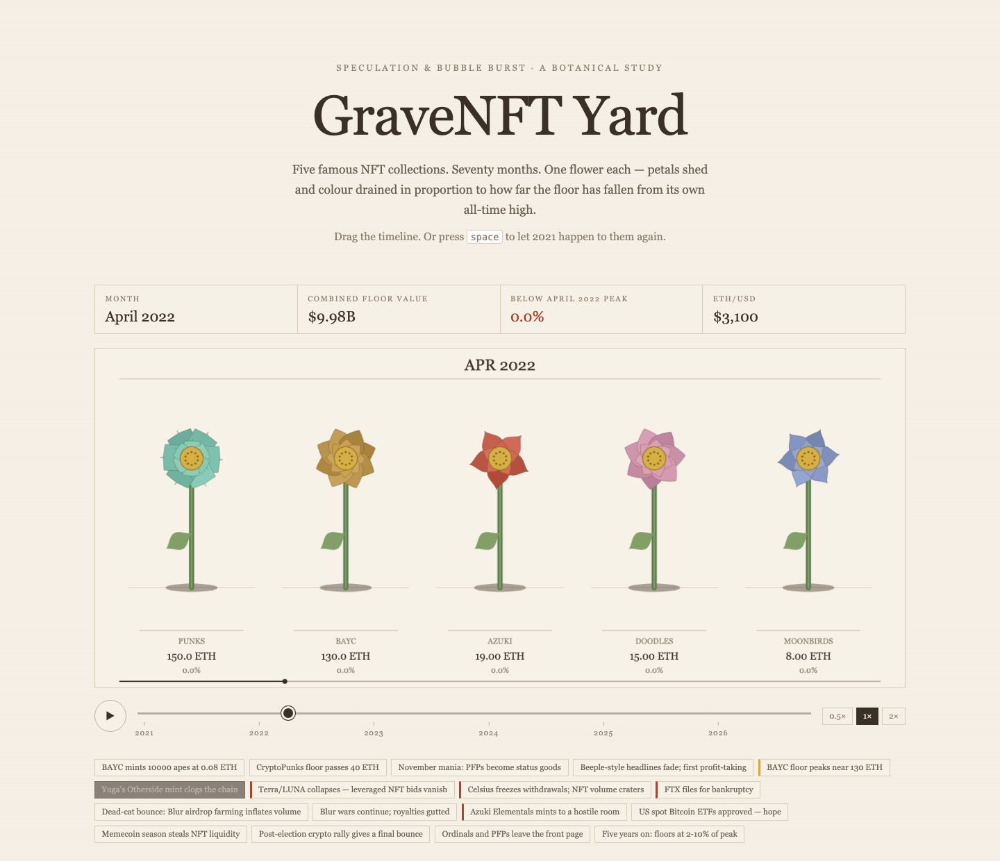
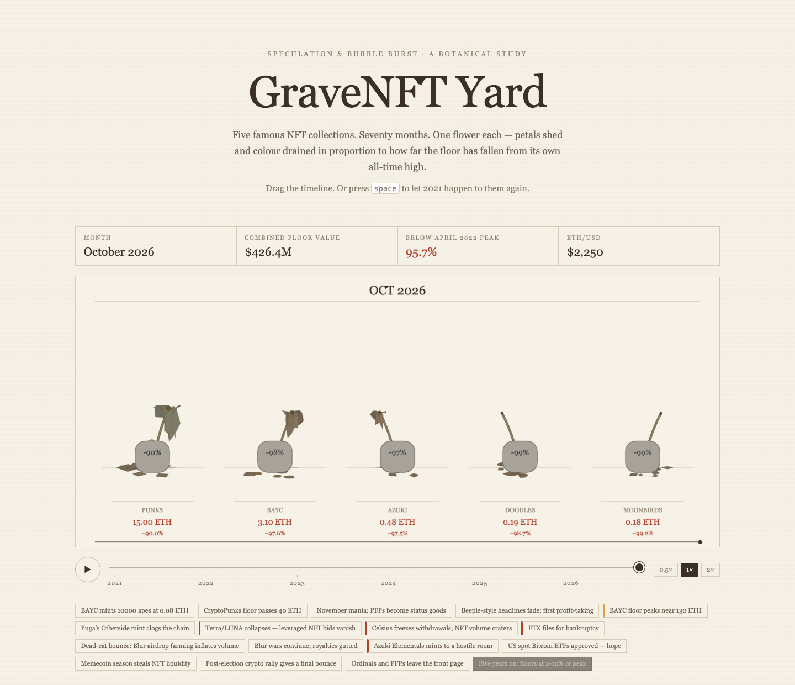

# 🪦 GraveNFT Yard

**An economic autopsy of five blue-chip NFTs — told in flowers that wilt with the floor price.**

  

In **April 2022** the five most famous NFT collections on Earth held **$9.98 billion** of floor value — 3.22M ETH under five species of pixel botany. By **October 2026** they hold **$426 million**. **95.7% of it is gone.**

This project grows that number as a garden. Every collection is a flower. Every month is a frame. The floor price decides whether it blooms — or rots on the vine.

- 🌸 **Interactive** — scrub 70 months on the live site: play, pause, 0.5×/1×/2×, jump to any of 17 market events, share any month as a URL
- 🌾 **Generative art** — one price→botany engine, drawn twice: Pillow prints the specimen plates, canvas animates the live garden
- 📉 **Honest economics** — monthly floors in ETH *and* USD, drawdowns from running all-time highs, event-annotated, provenance documented
- ✅ **Tested** — 69 pytest checks pin the headline numbers and prove the wilt mapping is monotone, bounded, and deterministic

---

## 🖼️ The garden

Drag the timeline and watch the money leave. **April 2022 — the top of the bubble:**

  

**October 2026 — the aftermath.** Colour drained to leaf-litter brown, petals shed on the soil, stems collapsed, and a headstone per flower engraved with its drawdown. Only CryptoPunks stand at −90%; the rest are down 97–99%:

  

> **Open the live site →** [maanas-pab.github.io/nft-graveyard-economics](https://maanas-pab.github.io/nft-graveyard-economics/)
> Deep links work: [`#2022-04`](https://maanas-pab.github.io/nft-graveyard-economics/#2022-04) opens the peak,
> [`#2026-10`](https://maanas-pab.github.io/nft-graveyard-economics/#2026-10) opens the aftermath,
> [`#play`](https://maanas-pab.github.io/nft-graveyard-economics/#play) plays all 70 months.

---
