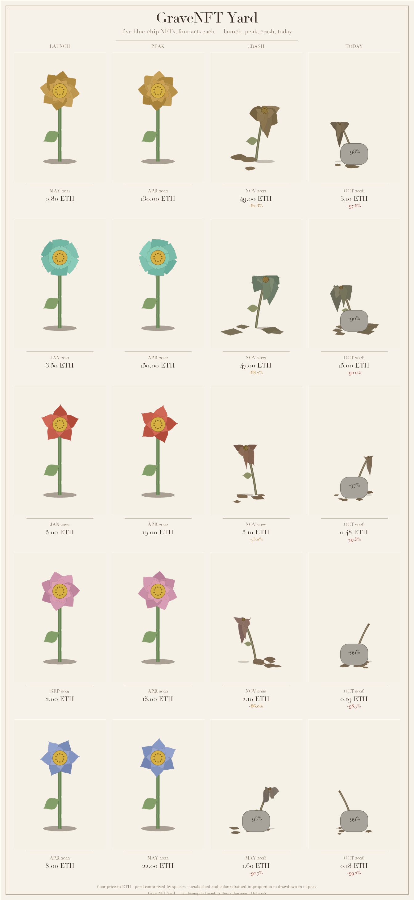
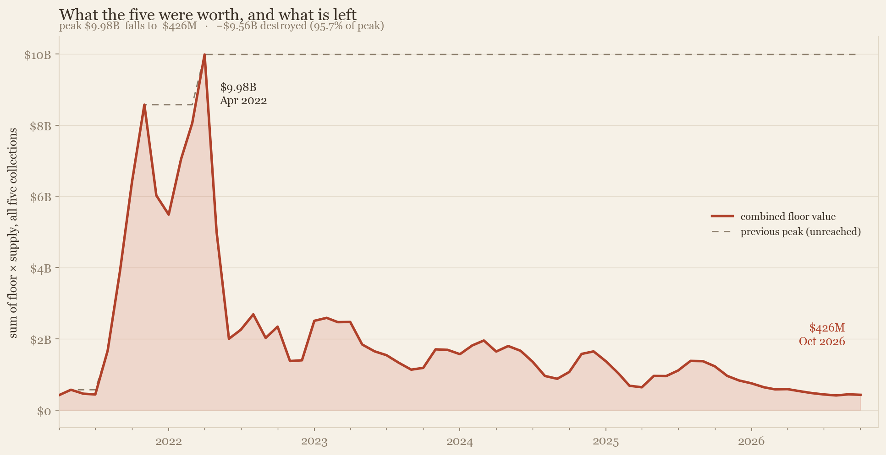
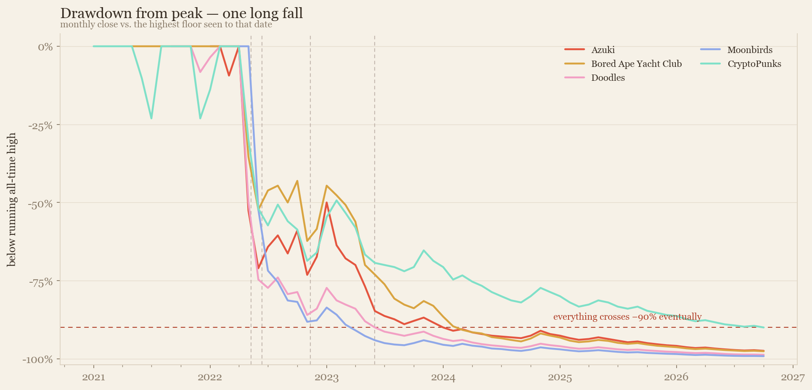
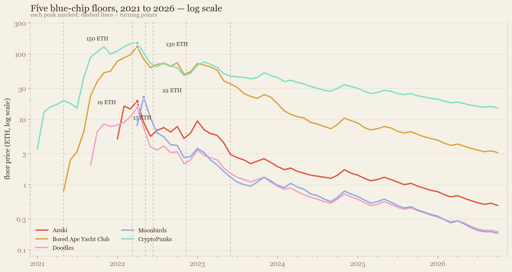
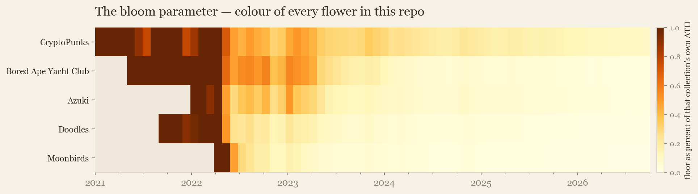
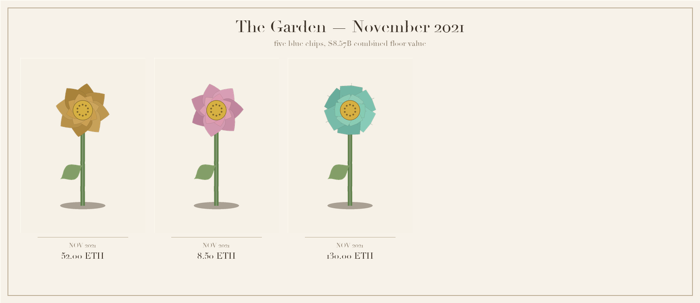
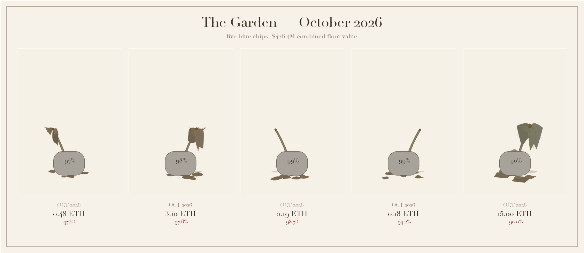

# GraveNFT Yard

**An economic autopsy of five blue-chip NFTs — told in flowers that wilt with the floor price.**

[](https://github.com/maanas-pab/nft-graveyard-economics/actions/workflows/ci.yml)
[](https://maanas-pab.github.io/nft-graveyard-economics/)
[](https://github.com/maanas-pab/nft-graveyard-economics/actions/workflows/ci.yml)
[](LICENSE)

<p align="center">
  
</p>

In **April 2022** the five most famous NFT collections on Earth held **$9.98 billion** of floor value — 3.22M ETH under five species of pixel botany. By **October 2026** they hold **$426 million**. **95.7% of it is gone.**

This project grows that number as a garden. Every collection is a flower. Every month is a frame. The floor price decides whether it blooms — or rots on the vine.

- **Interactive** — scrub 70 months on the live site: play, pause, 0.5×/1×/2×, jump to any of 17 market events, share any month as a URL
- **Generative art** — one price→botany engine, drawn twice: Pillow prints the specimen plates, canvas animates the live garden
- **Honest economics** — monthly floors in ETH *and* USD, drawdowns from running all-time highs, event-annotated, provenance documented
- **Tested** — 69 pytest checks pin the headline numbers and prove the wilt mapping is monotone, bounded, and deterministic

---

## The garden

Drag the timeline and watch the money leave. **April 2022 — the top of the bubble:**

<p align="center">
  
</p>

**October 2026 — the aftermath.** Colour drained to leaf-litter brown, petals shed on the soil, stems collapsed, and a headstone per flower engraved with its drawdown. Only CryptoPunks stand at −90%; the rest are down 97–99%:

<p align="center">
  
</p>

> **Open the live site →** [maanas-pab.github.io/nft-graveyard-economics](https://maanas-pab.github.io/nft-graveyard-economics/)
> Deep links work: [`#2022-04`](https://maanas-pab.github.io/nft-graveyard-economics/#2022-04) opens the peak,
> [`#2026-10`](https://maanas-pab.github.io/nft-graveyard-economics/#2026-10) opens the aftermath,
> [`#play`](https://maanas-pab.github.io/nft-graveyard-economics/#play) plays all 70 months.

---

## How price becomes botany

Every visual property of a flower is a pure function of two numbers: the current floor and the collection's running all-time high. Let **`r = floor / ATH`** (clipped to 0–1):

| Parameter | Formula | What you see |
|---|---|---|
| **Bloom size** | `0.085 + 0.115 · ln(1+floor) / ln(1+ATH)` | head radius. Log scale, because a 130 ETH floor is 43× the price of 3 ETH but must not be 43× the bloom |
| **Droop** | `(1 − r)^1.15` | the stem bows and the petals sag toward the soil |
| **Petal shed** | `((0.55 − r) / 0.55)^1.4` | petals detach and lie flattened on the ground — **zero above 55% of ATH**, then accelerating |
| **Saturation** | `0.18 + 0.82 · r^0.65` | colour drains toward leaf-litter brown |
| **Value** | `0.30 + 0.70 · r^0.55` | the bloom darkens as it dies |
| **Stem lean** | `droop × ±0.16` | mirror-image lean, alternating by seed so the row never looks stamped |
| **Headstone** | when drawdown ≤ −90% | engraved with the number: `−97%`, `−99%` |

Two curves do the emotional work. **Shed** is flat until the floor breaks — nothing falls while prices are merely "down a bit" — then petals drop off in a rush. **Saturation** uses `r^0.65`, so colour fades slowly at first and then all at once, which is what the crash actually felt like.

### Five species, one per collection

| Collection | Genus | Petals | Petal shape | Accent | Launched |
|---|---|---:|---|---|---|
| CryptoPunks | *Pixela* | 6 | blocky | `#7FE0C8` | 2017-06 (free claim) |
| Bored Ape Yacht Club | *Simia* | 8 | round | `#D9A441` | 2021-05 @ 0.08 ETH |
| Azuki | *Phaseolus* | 5 | pointed | `#E4553F` | 2022-01 @ 1.00 ETH |
| Doodles | *Pictura* | 7 | round | `#F2A0C4` | 2021-09 @ 0.12 ETH |
| Moonbirds | *Strix* | 6 | pointed | `#8FA8E8` | 2022-04 @ 1.50 ETH |

The whole graveyard at four moments each — **launch · peak · crash · today** — one row per species:

<p align="center">
  
</p>

---

## Four views of the collapse

Everything below is rendered by `src/charts.py` straight from the CSVs — no chart is hand-drawn.

<table>
<tr>
<td width="50%">
  <a href="assets/charts/destruction.png"></a>
  <br><sub><b>The scoreboard.</b> Sum of floor × supply across all five: $9.98B → $426M, <b>$9.56B destroyed (95.7%)</b>. The dashed line is the peak never re-touched.</sub>
</td>
<td width="50%">
  <a href="assets/charts/drawdown.png"></a>
  <br><sub><b>One long fall.</b> Each month's close vs. the highest floor ever seen. Everything crosses the −90% line — CryptoPunks last, at −90.0%.</sub>
</td>
</tr>
<tr>
<td width="50%">
  <a href="assets/charts/prices.png"></a>
  <br><sub><b>The raw floors, log scale.</b> Peaks annotated (Punks 150, BAYC 130, Doodles 15, Azuki 19, Moonbirds 22 ETH); dashed lines mark recorded turning points.</sub>
</td>
<td width="50%">
  <a href="assets/charts/bloom.png"></a>
  <br><sub><b>The engine's input.</b> <code>floor / ATH</code> per month — the exact number that sets every flower's colour, size, and droop. Dark = blooming, pale = dead.</sub>
</td>
</tr>
</table>

---

## Specimen plates

The same engine, frozen in print. `src/plates.py` renders Pillow plates for the README, the site, and per-collection lifecycles (`assets/plates/lifecycle_bayc.png`, `…_punks.png`, `…_azuki.png`, `…_doodles.png`, `…_moonbirds.png`).

**November 2021 — PFPs are status goods, the garden at maximum mania:**

<p align="center">
  
</p>

**October 2026 — five years on, the same plate rebuilt from the same CSVs:**

<p align="center">
  
</p>

---

## The ledger

Headline numbers, computed by `src/pipeline.py` and pinned by the test suite:

| | |
|---|---|
| **Peak** (Apr 2022) | **$9,982,000,000** combined floor — 3,220,000 ETH |
| **Today** (Oct 2026) | **$426,375,000** — 189,500 ETH |
| **Destroyed** | **$9,555,625,000 (95.7%)** — never re-touched the old peak |
| **Deepest drawdown** | Moonbirds **−99.2%** (22 ETH → 0.18 ETH) |
| **ETH/USD range** | $1,200 → $4,500 over the window |

| Collection | ATH | ATH month | Peak value | Floor today | Drawdown |
|---|---:|---|---:|---:|---:|
| CryptoPunks | 150.00 ETH | 2022-04 | $4.65B | 15.00 ETH ($33,750) | **−90.0%** |
| Bored Ape Yacht Club | 130.00 ETH | 2022-04 | $4.03B | 3.10 ETH ($6,975) | **−97.6%** |
| Azuki | 19.00 ETH | 2022-04 | $589M | 0.48 ETH ($1,080) | **−97.5%** |
| Doodles | 15.00 ETH | 2022-04 | $465M | 0.19 ETH ($428) | **−98.7%** |
| Moonbirds | 22.00 ETH | 2022-05 | $484M | 0.18 ETH ($405) | **−99.2%** |

Seventeen recorded events annotate the timeline — from *"BAYC mints 10000 apes at 0.08 ETH"* through Terra, Celsius, FTX, the Blur bounce, and *"Five years on: floors at 2-10% of peak."* Full provenance and caveats live in [`data/README.md`](data/README.md).

---

## Driving the garden

| Control | Action |
|---|---|
| **Slider** | scrub any of the 70 months by hand |
| **▶ / ⏸** | play the whole crash; press again at the end to replay |
| **0.5× · 1× · 2×** | playback speed |
| **Space** | play / pause |
| **← →** | step one month; **Home** / **End** jump to 2021 / 2026 |
| **Event chips** | click any of the 17 turning points to teleport there |
| **URL hash** | `#2022-04` shares a month, `#play` auto-starts the show |

Every readout — combined value, % destroyed, ETH price, per-collection floors and bars — recomputes from `site/data/garden.js` on each frame. Nothing on the page is a hardcoded number.

---

## Reproduce it

```bash
git clone https://github.com/maanas-pab/nft-graveyard-economics.git
cd nft-graveyard-economics
python3 -m venv .venv && source .venv/bin/activate
pip install -r requirements.txt

make all      # metrics + specimen plates + charts + GIF + site payload
make test     # 69 data-integrity & unit tests

# then browse the garden locally
python3 -m http.server 8931 --directory site
# → http://localhost:8931/#play
```

Requires Python 3.10+, `pandas`, `Pillow`, `matplotlib`, `pytest` — see [`requirements.txt`](requirements.txt).

CI runs the whole suite on every push **and** re-exports `site/data/garden.js` from the CSVs, failing if a single byte differs from the committed artifact — the site can never drift away from the data.

---

## Repository structure

```
nft-graveyard-economics/
├── data/                    hand-compiled CSVs — floors, ETH/USD, metadata, events
│   └── README.md            provenance, coverage, and honest caveats
├── src/
│   ├── pipeline.py          pandas: ATH, drawdowns, market value, web payload
│   ├── flower.py            Pillow: the price → botany engine
│   ├── plates.py            specimen plates + the 5×4 lifecycle contact sheet
│   ├── charts.py            the four economics charts
│   └── garden_gif.py        70-frame wilting animation
├── site/                    the interactive garden — no framework, no build step
│   ├── index.html
│   ├── assets/flower.js     canvas port of flower.py (same math, mulberry32 RNG)
│   ├── assets/app.js        timeline, playback, readouts, deep links
│   └── data/garden.js       payload exported by `make site`
├── tests/                   69 checks: data integrity, wilt math, pipeline stats
├── assets/                  generated art, committed (plates, charts, GIF, shots)
├── .github/workflows/ci.yml pytest + payload reproducibility
└── Makefile                 make all / data / flowers / charts / gif / site / test
```

---

## License and disclaimers

MIT — see [`LICENSE`](LICENSE).

Floor prices are **hand-compiled monthly approximations** of observed marketplace floors, good enough to trace the shape of the bubble and its collapse, and **not** settlement data. Monthly sampling understates the real drawdowns, the sample is survivor-biased toward famous projects (thousands of collections went to exactly zero and aren't here — making these losses a *lower* bound), and nothing in this repo is financial advice. Details in [`data/README.md`](data/README.md).
